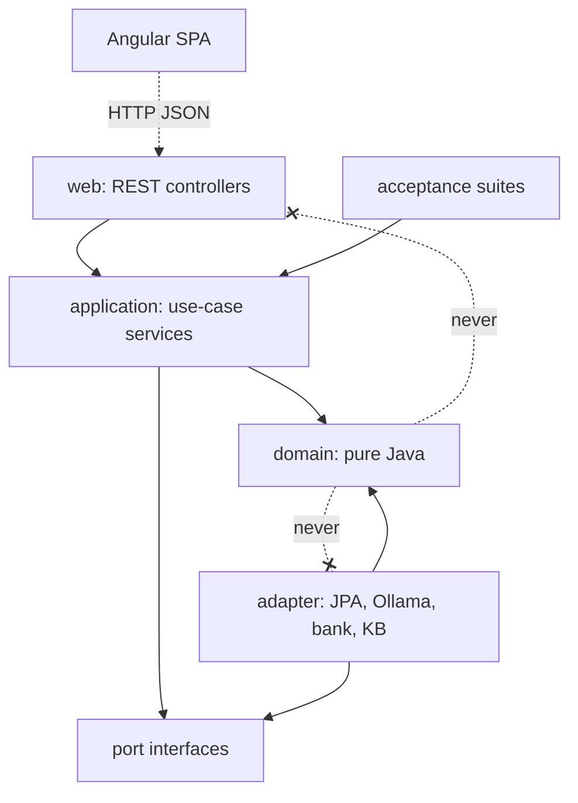
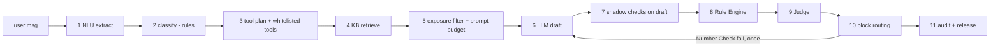
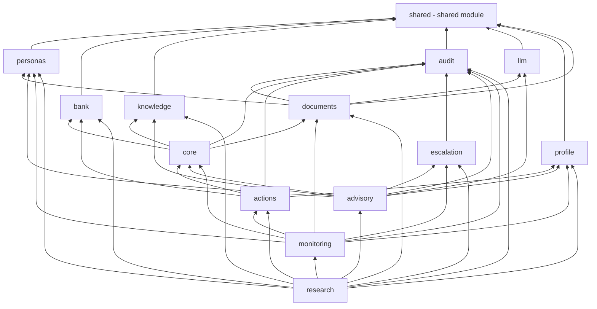
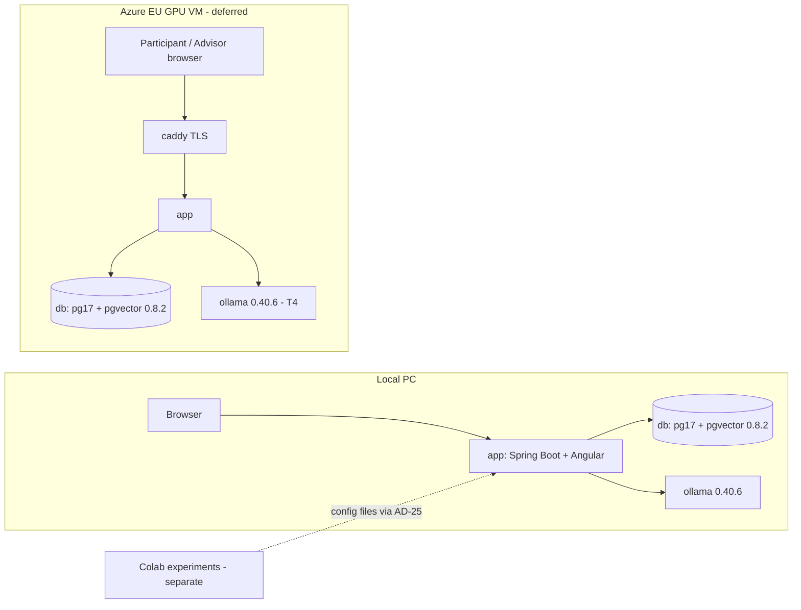
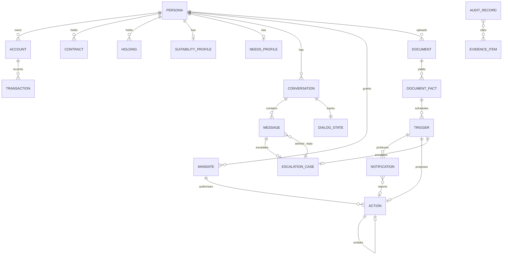
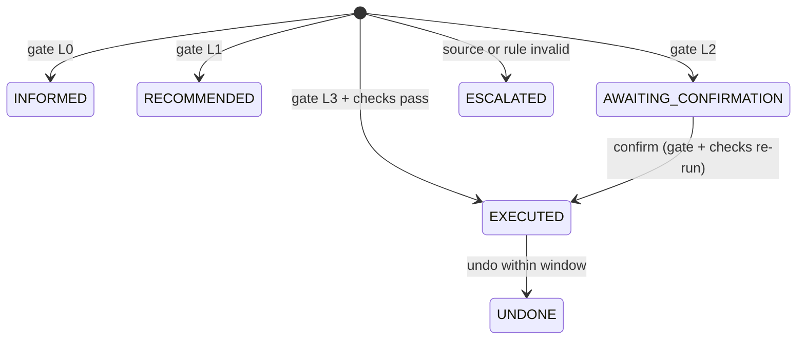

# Architecture Spine: Autonomous Hybrid Finance Agent (Final Application)

## Design Paradigm

**A modular monolith with a hexagonal domain core**, built on Spring Boot. One backend process holds every module, and Spring Modulith application modules make module ownership explicit and verifiable.

- **The domain.** The deterministic inside (`..domain..` packages) is plain Java. It has no Spring, no JPA, no I/O and no LLM.
- **Ports and adapters.** Ports declare what the inside needs, and adapters implement them at the edge: JPA, Ollama REST, sandbox bank, web, the Knowledge Base.
- **The turn pipeline.** The advisory turn is a **fixed pipes-and-filters pipeline**. The orchestrator owns it, and its stage order is code, not model output.
- **The frontend.** An Angular SPA is built into the backend image and talks to it over typed REST.

The Colab experiments are a separate, independent instrument. Their results enter this application only as configuration (AD-25).

| Layer | Location | Holds |
|---|---|---|
| Domain (pure Java) | `<module>.domain` | Deterministic Core, profile completeness, classification rules, Check Chain and routing, Number Check, Autonomy Gate, Trigger detection, exposure filter, records and value objects |
| Application | `<module>.application` | Use-case services (transaction boundaries), orchestrator, CoreGateway |
| Ports | `<module>.port` | `LlmPort`, `BankPort`, `KnowledgePort`, `RuleParamPort`, `ClockPort`, repository interfaces |
| Adapters | `<module>.adapter` | JPA repositories, Ollama REST client, sandbox bank, pgvector KB, YAML rule params |
| Web | `<module>.web` + `frontend/` | Spring MVC REST controllers; Angular SPA |



## Invariants & Rules

### AD-1: Dependency direction and the pure domain

- **Binds:** all modules; FR-12, FR-20, FR-25, FR-35
- **Prevents:** I/O, LLM calls or framework types leaking into the code that produces numbers, approvals or autonomy levels.
- **Rule:**
  - **Allowed dependencies.** Classes in `..domain..` depend only on `java.*` and other `..domain..` classes. This includes `shared.domain`, which holds the cross-module value types `SourcedNumber`, `Unit`, `Money`, `PersonaId`, `CheckId` and `ResponseOutcome`.
  - **No framework types.** They use no Spring, Jakarta, JPA, Jackson or HTTP annotations and types.
  - **Pure functions.** Domain functions are pure. All inputs (including `asOf`, seeds, Rule Parameter values and thresholds) arrive as plain arguments, never as `RequestContext`.
  - **Enforcement.** An ArchUnit test enforces this.

### AD-2: One provenance-carrying result type, with stable figure keys

- **Binds:** Deterministic Core, Rule Parameters, KB, Number Check, "Why?" view, Overview highlight, Audit; FR-8, FR-12, FR-20, FR-21, FR-22, FR-23, FR-33
- **Prevents:** per-function return shapes, and ids that differ between chat and panel for the same figure, so that the FR-8 highlight never matches and "Why?" lookups fail.
- **Rule:**
  - **Result shape.** Every Core function returns a `CoreResult` record with `function`, `inputs`, `outputs`, `assumptions`, `ruleParamVersions` and `List<SourcedNumber>`.
  - **SourcedNumber.** A `SourcedNumber(provId, BigDecimal value, Unit unit, String label)` uses the closed `Unit` enum `EUR | FRACTION | PP | MONTHS | YEARS | COUNT`.
  - **Figure key.** `provId` is a deterministic figure key: the first 16 hex characters of the SHA-1 over `personaId`, function, canonical inputs, `asOf`, the config fingerprint (AD-14) and output key.
  - **Single entry point.** All Core calls, including the shortfall and liquidity figures that monitoring and actions use, go through `core.CoreGateway`. The gateway persists each item through `audit.EvidenceStore.putIfAbsent(...)`. `audit` owns the append-only `evidence_items` table. `/api/provenance/{provId}` lives in `audit.web`, is persona-scoped, and reads only that table.
  - **Per-turn ledger.** The orchestrator builds a per-turn `Evidence` ledger from these items, plus cited KB passage numbers, Rule Parameter values and user-message numbers. The Number Check and the Audit Record read only that ledger.
  - **Forecasts.** A forecast without `assumptions` and a range (p10/p50/p90 or min/max) fails validation.
  - **What-if spec.** Chat what-ifs and `/api/simulate` share one `SimulationSpec`. Its seed is taken from `RequestContext.seeds` by the use case, never from the client.
  - **Document Facts.** A confirmed Document Fact is a `SourcedNumber` whose `provId` comes from the function `documentFact` with inputs `documentId` and field. While the Document exists, the "Why?" endpoint shows the Document excerpt at the stored location. After deletion it shows "letter deleted". Evidence items store the location, never the excerpt text.

### AD-3: The turn pipeline has one fixed order, one owner and one flags table

- **Binds:** orchestrator; FR-9 to FR-16, FR-25, FR-26, FR-43, FR-44, FR-52; SM-2, SM-3
- **Prevents:** stages reordered or skipped per feature, the LLM choosing tools, and compliance levels implemented as scattered `if`s.
- **Rule:** only the `advisory` module's orchestrator runs a chat turn. Before stage 1, it consults the conversation's `DialogState` (AD-24).



  A `ComponentFlags` lookup is the only place where the configured compliance level is interpreted.

| Stage | A | A+B | A+B+C |
|---|---|---|---|
| 1–2 NLU + classification | given as instruction | given | given |
| 3 Core tools | given | given | given |
| 4 KB retrieval | per config | per config | per config |
| 7 Shadow checks on first draft | computed | computed | computed |
| 8 Rule Engine | shadow | enforcing | enforcing |
| 9 Judge | off | off | on |
| 10 Block routing | off (outcome = class) | on | on |

  The tool plan is a pure function of the class and the extracted parameters. The whitelist is one registry bean. The LLM never names, selects or calls a tool, and chat never proposes Actions. The default compliance level is set by AD-25.

### AD-4: Classification uses a pinned NLU role plus deterministic rules

- **Binds:** FR-9, FR-10, FR-17, FR-33, FR-44, FR-45
- **Prevents:** classification quality changing whenever the phrasing model changes, and three different notions of "profile complete".
- **Rule:**
  - **Extraction.** A dedicated `nlu` model role extracts intent, topic, scope signals, what-if parameters and any profile facts the user states. It runs at temperature 0 with a fixed seed and an Ollama JSON-schema `format`, and results are cached by model digest, prompt hash and input hash.
  - **Classification.** Pure rules in `advisory.domain` derive the Expected Behavior class from intent, topic, scope and `profile.ProfileCompleteness.evaluate(...)`. That function lives in `profile`'s API and is the single implementation used by chat, gate and UI.
  - **Status of NLU output.** NLU output is data only.

### AD-5: The LLM is an untrusted text edge behind one port

- **Binds:** `LlmPort`, the roles `phrasing`, `nlu` and `judge`; FR-43 to FR-46
- **Prevents:** model-specific code paths, raw persona data reaching the model through the prompt or chat history, truncated prompts, and LLM output being parsed into actions or profile writes.
- **Rule:**
  - **One port.** All model calls go through `LlmPort.generate(role, messages, decoding, schema)`, which returns `LlmResult(text, modelTag, digest, decoding, promptTokens, truncated, latency)`.
  - **Adapter.** The adapter is a thin client on Spring `RestClient` over Ollama's native `/api/chat` and `/api/embed`. Spring AI is not used.
  - **Exposure filter.** The phrasing role receives only a `PromptPayload` built by the exposure filter at the configured Data Exposure Level. Implemented levels are `aggregated` and `none` (PRD FR-43); `raw` or `pseudonymised` is added only if E4 selects it. The filter also covers the chat history, which is limited to the last released turns. User input, retrieved text and Document text go only into delimited data slots. The `nlu` role also serves Document type detection and extraction (AD-26).
  - **Prompt budget.** Every chat model has a configured `numCtx` and a fixed prompt budget. Truncation drops history first and KB passages second. It never drops Core results or the system part, and any truncation is recorded.
  - **Output handling.** LLM output is treated as text only.
  - **Prompt files.** Prompts are versioned files in `config/prompts/`, and their hash is recorded per call. They carry the PRD §5 tone rules for vulnerable users.

### AD-6: Only the Rule Engine approves; one routing function decides the outcome

- **Binds:** Rule Engine, Judge, block routing, Escalation; FR-10, FR-13, FR-22, FR-25 to FR-27, FR-29, FR-41, FR-52
- **Prevents:** a second approval path, inconsistent mapping from block reason to outcome, unrecorded checks, and plain no-source answers being escalated needlessly.
- **Rule:**
  - **Check Chain.** The Check Chain is an ordered list of deterministic `Check`s from the closed `CheckId` enum: `SCOPE`, `PROFILE_COMPLETE`, `SUITABILITY`, `COST_TRANSPARENCY`, `NO_PRODUCT_NAMING`, `NO_GUARANTEE_OR_TIMING`, `CONFLICT_OF_INTEREST`, `IDD_NEEDS`, `DOCUMENTATION`, `NUMBER_MATCH`, `SOURCE_VALIDITY`. Each returns `CheckResult(checkId, applicable, passed, reasonCode, details)`.
  - **Release.** A response is released only when every applicable check passes.
  - **Judge.** The Judge returns `NONE | BLOCK | ESCALATE`. Unparseable Judge output counts as `NONE` and is recorded as a parse failure. The Judge is skipped once the Rule Engine has blocked.
  - **Routing.** `BlockRouting.route(results)` is the only implementation of the FR-52 table. A Number Check failure triggers exactly one regeneration.
  - **Missing sources.** When retrieval finds no valid source for `INFORM`, the turn releases a fixed "no valid source" template with outcome `INFORM` (FR-13).
  - **Escalation cases.** An invalid Rule Parameter that the Core needs at `asOf`, or an expired passage cited in the draft, routes to `ESCALATE`.
  - **Retrieval off.** With retrieval off, `SOURCE_VALIDITY` is not applicable.
  - **Persistence.** All `CheckResult`s, shadow and enforcing, are persisted.

### AD-7: Release is atomic with its Audit Record; no streaming

- **Binds:** chat API, orchestrator, actions, monitoring, audit; FR-25, FR-28, FR-41, FR-42
- **Prevents:** text reaching the user before checks finish, and released responses, Notifications or Actions without an Audit Record.
- **Rule:**
  - **No streaming.** The chat endpoint returns one complete, released turn.
  - **One transaction.** One transaction (AD-21) holds everything a turn writes: the Audit Record, the chat message, the evidence items, any `EscalationCase`, any Notification, any Action state change and any bank mutation. If the audit write fails, nothing is released.
  - **One outcome per turn.** Each chat turn ends in exactly one `ResponseOutcome`: one of the six Expected Behavior classes, or `ESCALATE`.

### AD-8: Time comes from the persona's simulated clock

- **Binds:** Core, monitoring, Rule Parameters, KB retrieval, Actions, Undo window; FR-3, FR-22, FR-23, FR-31, FR-38, FR-48
- **Prevents:** results that change with the real date.
- **Rule:**
  - **No wall clock in logic.** Domain and application code never call `LocalDate.now()`, `Instant.now()` or `Clock.systemDefaultZone()` for domain logic.
  - **Simulated date.** `asOf` comes from `RequestContext.asOf()` (AD-22), which reads the persona's stored `simulatedDate`.
  - **Technical timestamps.** Wall-clock time is used only for technical `createdAt` timestamps.
  - **Enforcement.** An ArchUnit rule forbids `now()` calls in `..domain..` and `..application..`.

### AD-9: Reference data is versioned files with validity windows, pinned by snapshot

- **Binds:** Rule Parameters, KB, Subsidy Calculator; FR-13, FR-22, FR-23, FR-24, FR-30; OQ4
- **Prevents:** rule values edited in place, and the KB served from an ingest that does not match the files.
- **Rule:**
  - **Rule Parameters.** Rule Parameters live in `data/rules/*.yaml` as entries `(key, value, unit, validFrom, validTo, source, version)`. Changes are append-only.
  - **KB documents.** KB documents live in `data/kb/*.md` with front matter `(docId, source, version, validFrom, validTo)`.
  - **Ingest.** Ingest is a startup task. It embeds the documents with one pinned embedding model, calling Ollama `/api/embed` with `truncate: false` so that chunks that are too long fail instead of being silently cut. It stores a **KB snapshot id** in the database: a content hash over the LF-normalised files and the embedding model digest.
  - **Rule snapshot.** The rule snapshot id is the hash of the LF-normalised `data/rules` files. It is part of the config fingerprint (AD-14).
  - **Rule Parameter access.** Rule Parameters are read through `knowledge.RuleParamPort`, which `core` uses.
  - **Startup check.** The application refuses to start if the file snapshot differs from the ingested snapshot. In that case, re-ingest first.
  - **Lookup errors.** A lookup with nothing valid at `asOf` raises `NoValidRuleParameterException` or `NoValidSourceException`, routed per AD-6.
  - **Open content.** The corpus content and the reference date are open (OQ4).

### AD-10: Actions follow one state machine, through the Autonomy Gate

- **Binds:** `actions` module, Autonomy Gate, Mandates, Notifications, Bank Adapter; FR-35 to FR-40, FR-44; SM-5, SM-C3
- **Prevents:** Actions executed without the gate, duplicate rows on L2 confirmation, one-tap Undo capped by the gate, two Data Confidence values for one Scenario, and Actions skipping the Check Chain.
- **Rule:** `ActionService` is the only writer of `actions` and `mandates`. It has four entry points.
  - **`propose(ProposedAction)`.** Only monitoring calls it. A `ProposedAction` carries action facts only: type, class, amount, source and target accounts, and `triggerId`. The gate context is built by `ActionService` alone, from four inputs:
    - one `bank.BankReadPort.snapshot(personaId, asOf)`, already filtered to `asOf`;
    - the measures from `core.domain` (`DataConfidence.of(...)`, `Liquidity.liquidAssets(...)`, the emergency-fund floor after the Action), each defined once, with thresholds passed in as arguments;
    - `suitabilityComplete` from `profile.ProfileCompleteness`;
    - the Mandate lookup.

    `AutonomyGate.decide(action, context, thresholds)` returns `GateDecision(level, cappingCriteria)`. The applicable checks run before execution. The resulting state is `INFORMED | RECOMMENDED | AWAITING_CONFIRMATION | EXECUTED | ESCALATED`. L3 is possible only for `EF_TOP_UP` and `SHORTFALL_TRANSFER`. Actions of the `insurance` and `legal` classes are never executed. `DRAFT_TERMINATION_LETTER` (class `legal`, AD-27) is capped at L1 by the gate row for `legal` (FR-35).
  - **`confirm(actionId)`.** Re-runs the gate and the checks on the **same row**, then executes.
  - **`undo(actionId)`.** Allowed for `EXECUTED` L3 Actions within the reversibility window of one business day, measured by the simulated clock. It does **not** pass the gate. It creates a compensating Action linked by `undoesId`, and the original Action becomes `UNDONE`.
  - **`revoke(mandateId)`.** Sets `revokedAt` and never deletes. Mandate validity is re-checked at every execution.
  - **Execution path.** Execution happens only through `BankPort`.

### AD-11: Persona isolation is enforced server-side

- **Binds:** web layer, repositories; FR-1, FR-2, FR-3, FR-42
- **Prevents:** cross-persona reads through a client-supplied id, and the advisor acting inside a persona workspace.
- **Rule:**
  - **Login.** Spring Security 7 session login: `POST /api/auth/login` returns JSON 200 or 401 and never redirects. CSRF is set up with `csrf(c -> c.spa())`, which matches Angular's `XSRF-TOKEN` / `X-XSRF-TOKEN` defaults.
  - **Roles.** The roles are `PERSONA`, `ADVISOR` and `RESEARCHER`.
  - **Persona endpoints.** Persona endpoints take the persona id only from the authenticated principal. Persona-scoped repository methods require a `PersonaScope`.
  - **Advisor endpoints.** `/api/advisor/**` can only read escalation cases, post replies and close cases. There is no advisor UI; the advisor uses Swagger UI or `deploy/research/advisor.sh`.
  - **Research endpoints.** `/api/research/**` covers reset, simulated date, monitoring run, study preparation and audit export. A study preset may set a `plantedOverride` for one Document type and field, which swaps a grounded value into a different field on the Fact Card (PRD §8.4). The override is recorded in the `DOCUMENT_EXTRACTION` Audit Record. It exists only with the Spring profile `research`. Researcher actions (reset, simulated date) are written to the application log, not as Audit Records (Epic 1 as-built). There is no Research Console UI: research endpoints are used through Swagger UI (research profile only) and scripts in `deploy/research/`, and the `RESEARCHER` login lands on Swagger UI.

### AD-12: Each module owns its tables; cross-module changes go through the owner

- **Binds:** all persistence; FR-3, FR-17, FR-18, FR-41, FR-42
- **Prevents:** two modules writing one entity with different invariants.
- **Rule:**
  - **Owners.** The Spring Modulith modules below are the only writers of their tables.
  - **Module API.** A module's API is the types in its **base package** plus any named interface it declares. A port used by another module is declared in the providing module's base package (e.g. `llm.LlmPort`, `bank.BankReadPort`, `knowledge.RuleParamPort`, `audit.EvidenceStore`). Sub-packages are internal. Two exceptions (Epic 2 as-built):
    - `shared.RequestContextFactory` lives in the open `shared` module, because `core` use cases build a `RequestContext` and `core` may not depend on `personas`.
    - The types `CoreGateway` returns stay in `core.domain` (the domain functions build them, AD-1) and form the named interface `results`; a caller allows `"core :: results"` next to `"core"`. It exposes exactly the types the gateway signatures reach, so the Core's functions stay behind the gateway (AD-2). `ModulithTest` checks this.
  - **No shared entities.** Module APIs exchange only immutable records, never JPA entities. A reference across modules is an id only: no JPA associations and no foreign keys across modules.
  - **Dependency direction.** Modules depend only along the graph below.
  - **Cycles and events.** The only cycle-breaker is a synchronous `@EventListener` inside the caller's transaction, for example `escalation` publishes `AdvisorReplyPosted` and `advisory` appends the message. `@ApplicationModuleListener`, `@Async` and `@TransactionalEventListener` are not allowed.
  - **Enforcement.** `ApplicationModules.verify()` runs as a test.



| Module | Tables | Notes |
|---|---|---|
| `bank` (sandbox) | accounts, transactions, contracts, holdings, savings_plans | Mutated only via `BankPort` by `actions` |
| `profile` | suitability_profiles, needs_profiles | Only writer. Values persisted only after the user confirms via a structured confirm control. Fields carry `confirmedAt`. |
| `advisory` (chat) | conversations, messages, dialog_states | `messages.author ∈ USER, AGENT, ADVISOR` |
| `monitoring` | triggers, notifications | Notifications are templated (no LLM), written after `propose()` and linked to `actionId`. Status is derived from the Action state. To-do Notifications (`DOCUMENT_DEADLINE`) carry their own `todoStatus` (`OPEN | DONE | DISMISSED`). |
| `actions` | mandates, actions | AD-10 |
| `documents` | documents, document_facts | Only writer (AD-26). Facts are usable only after `confirmFacts`. Publishes `DocumentFactsConfirmed`; `monitoring` listens synchronously. Read by `core` and `monitoring` only through `DocumentFactsPort`. |
| `escalation` | escalation_cases | Origin is `TURN` or `TRIGGER`. Holds a snapshot copy of the question, draft and block reasons. `reply()` publishes `AdvisorReplyPosted`. `advisory` listens synchronously and appends the advisor message. |
| `audit` | audit_records, evidence_items | Append-only (AD-13) |
| `knowledge` | kb_documents, kb_chunks, kb_snapshot | AD-9 |
| `personas` | personas, users, persona_state | `simulatedDate`, `fixtureVersion` |
| `research` | none | Reset, study preparation and audit export use cases. Reset calls each owner's `reset(personaId)` in reverse dependency order in one transaction, then reloads fixtures. Audit is never reset. |

### AD-13: Audit Records are append-only and self-describing

- **Binds:** audit, verification; FR-9, FR-27, FR-28, FR-29, FR-50; SM-2, SM-3, SM-5
- **Prevents:** evidence that is mutable, partial or not traceable to the active configuration.
- **Rule:**
  - **Append-only enforcement.** `audit_records` and `evidence_items` have triggers that reject UPDATE, DELETE and TRUNCATE. The app connects as a non-owner role with INSERT and SELECT only on these tables, and Flyway migrates as the owner.
  - **Record fields.** A record holds `kind (RESPONSE|ACTION|NOTIFICATION|DOCUMENT_EXTRACTION)`, `runId` (null outside acceptance runs), `personaId`, `turnId` or `actionId`, `fixtureVersion`, `schemaVersion` and a JSONB payload.
  - **Payload.** The payload contains the `asOf`, the class, outcome, evidence `provId`s, all `CheckResult`s, the Judge verdict and parse status, the gate decision with capping criteria, model tags and digests, prompt hashes, `truncated`, the config id and the config fingerprint (AD-14), the KB snapshot id, seeds, the first draft and the final text. It also records the selection inputs for a Category Recommendation (FR-27).
  - **Document extraction payload.** A `DOCUMENT_EXTRACTION` payload holds the Document sha256, the type, model tags and digests, the prompt hash, the redacted extraction JSON, the grounding and plausibility results, `truncated` and `plantedOverride`. It never holds Document text or unredacted values, so deleting a Document (FR-60) needs no change to audit records.
  - **Not audited.** Researcher actions (reset, simulated date) are logged, not recorded (AD-11).
  - **Serialisation.** The payload is serialised by one `AuditPayloadMapper`, not by Hibernate's internal JSON mapper, so that its format is fixed.
  - **Export.** Records are exportable as JSONL via `/api/research/audit/export` for requirement verification.

### AD-14: The agent configuration is versioned data

- **Binds:** advisory pipeline, LLM adapter; FR-24, FR-25, FR-43, FR-46
- **Prevents:** behaviour switched by code edits or undocumented flags.
- **Rule:**
  - **Configuration file.** The `AgentConfiguration` is one YAML file, `config/agent/<id>.yaml`, bound to `@ConfigurationProperties` and validated at startup. Its fields are `id`, `llm` (role → model tag for `phrasing`, `nlu` and `judge`), `retrieval`, `rolePrompt`, `compliance` (`A | A+B | A+B+C`), `dataExposure`, `decoding` and `seeds`.
  - **Selection.** The active file is selected by `APP_AGENT_CONFIG`.
  - **Config fingerprint.** At startup, one `ConfigFingerprint` is computed: a SHA-256 over the raw, LF-normalised bytes of every AD-25 file (agent config, prompts, `autonomy.yaml`, `profile-minimums.yaml`, `models/lock.json`), of `config/documents.yaml` and `config/letters/`, and of `data/rules`, in sorted path order. The fingerprint and the per-file hashes go into every Audit Record. `.gitattributes` forces LF for these paths.
  - **Rule Parameters.** `data/rules/rule_parameters.yaml` is read through `knowledge.RuleParamPort` (minimal since Story 2.3: key, value, unit, validity, a `source` note and version; Story 4.1 adds the legal source text and the AD-25 `derivedFrom` block). Values without an experiment behind them are design parameters and say so in `source`: `emergency_fund_months_min`/`_max`, `forecast_variable_spending_band` (±15 %), `projection_default_horizon_years`, and the parametric projection model's `projection_equity_mean_return` and `projection_equity_volatility`.
  - **File location.** `config/`, `data/` and `models/` are read from `APP_HOME` (repository root locally, `/app` in the image, mounted read-only in compose).
  - **No other flags.** No other feature flags exist.

### AD-15: Requirements are verified by acceptance suites against the same services

- **Binds:** verification of FR-1 to FR-48, FR-50 to FR-52; SM-2, SM-3, SM-4, SM-5, SM-7, SM-C3
- **Prevents:** requirement checks that test a different code path than users get, and persona-backed items running without their persona.
- **Rule:**
  - **Test location and tooling.** Acceptance suites live in `backend/src/test/.../acceptance`. They are JUnit 6 tests with Testcontainers (PostgreSQL 17 + pgvector 0.8.2, Ollama) and call the `*UseCase` entry points.
  - **No test transactions.** The tests are **not** `@Transactional`, so they exercise the same transaction boundaries as users. Each run sets a `runId`, which is recorded in every Audit Record it produces.
  - **Q&A suite.** The Q&A suite runs `experiments/sampleQuestions_variantB.csv`. Each item runs in a fresh conversation as the persona mapped in `experiments/item_personas.yaml`. That persona is reset to its fixture and simulated date first. Unmapped items run as `p-harness`, which has no stored profile. Parameter proposals (AD-24) are auto-confirmed.
  - **Scenario suite.** The scenario suite runs S1–S6, S9, S12a, S12b and S13: reset, then set `simulatedDate`, then `MonitoringService.run`, then assert the Trigger, Action and level.
  - **Deterministic layers.** Core reference values (item 40: 522/538; item 56: below −50 EUR), the gate table, the routing table and the flags table are plain unit tests.
  - **Document suite.** It runs the fixtures in `data/documents/` (each letter with its Ground Truth YAML) through `DocumentIntakeUseCase`. It asserts SM-10a = 0 and the red-team expectations, and reports SM-10b and SM-10c. Facts are auto-confirmed only in the setups of Scenarios S15, S16 and S18. The Scenario suite also runs S15–S19 (FR-61; S19 = ECB rate change as a Rule Parameter).
  - **Reports.** Each suite writes a verification report and the exported Audit Records to `target/verification/`.

### AD-16: Monitoring is an idempotent batch over simulated time

- **Binds:** `monitoring` module; FR-30, FR-31, FR-32
- **Prevents:** double Notifications or Actions on re-runs, and price movements entering as Triggers.
- **Rule:**
  - **Detection.** `MonitoringService.run(ctx, personaId)` calls the pure `TriggerDetection.detect(snapshot, asOf, rules)`.
  - **Idempotency.** Each Trigger has the key `(personaId, triggerType, subjectId, period)`, and existing keys are skipped.
  - **One run, one transaction.** A monitoring run is one use case in one transaction. For each Trigger it proposes the Action if one applies, writes the Notification, and opens an `EscalationCase` with origin `TRIGGER` on `ESCALATE` (S12b).
  - **Figures.** Every figure a Trigger cites comes from `CoreGateway` (AD-2).
  - **No market prices.** No detector reads market prices.
  - **Document deadlines.** `TriggerDetection` receives confirmed Document Facts from `DocumentFactsPort`. The key for `DOCUMENT_DEADLINE` is `(personaId, DOCUMENT_DEADLINE, factId, TODO | REMINDER)`. `TODO` fires on confirmation (via `DocumentFactsConfirmed`), and `REMINDER` fires within the lead time from `config/documents.yaml`. For a premium increase, the Trigger proposes `DRAFT_TERMINATION_LETTER` (AD-27).
  - **No scheduler.** There is no scheduler. Monitoring runs only via research endpoints, study preparation or the acceptance suites.

### AD-17: One image and one compose file

- **Binds:** build, deployment, environments
- **Prevents:** local and Azure environments that behave differently (runtime, quantisation, pgvector or DB).
- **Rule:**
  - **Image.** A multi-stage Docker build produces one image, with the Angular production build copied into Spring Boot's static resources.
  - **Compose file.** Both environments run the same `deploy/docker-compose.yml` with these services:
    - `app`;
    - `db` (`pgvector/pgvector:0.8.2-pg17`);
    - `ollama` (`ollama/ollama:0.40.6`, `OLLAMA_KEEP_ALIVE=-1`).
  - **Azure host (deferred).** One EU GPU VM (NCas_T4_v3, Sweden Central or West Europe) with `caddy` for TLS, only if a remote study becomes necessary. The user study runs locally in person (scope reduction 2026-10-21).
  - **Environment differences.** Environments differ only in environment variables: `SPRING_DATASOURCE_*`, `APP_OLLAMA_URL`, `APP_AGENT_CONFIG`, `SPRING_PROFILES_ACTIVE`, and the secrets.
  - **Development override.** `deploy/docker-compose.local.yml` only publishes `db` and `ollama` on 127.0.0.1 for running the backend outside compose. It is a development tool, not an environment (`DeploymentConfigTest` keeps it to loopback ports).

### AD-18: Models are pinned by digest and served by Ollama

- **Binds:** LLM adapter, model setup; FR-46
- **Prevents:** an untraceable model or runtime swap.
- **Rule:**
  - **Model files.** Every model bound in the active `AgentConfiguration`, plus the embedding model, is defined in `models/`. Pulled tags are listed there, and imported GGUFs (e.g. finance-chat) get a checked-in Modelfile with the correct chat template.
  - **Lock file.** `models/lock.json` records each tag, its `/api/tags` digest and the GGUF sha256.
  - **Startup checks.** At startup the adapter compares each bound tag's `/api/tags` digest with the lock and fails fast on a mismatch; `ggufSha256` is recorded only. A startup smoke test checks JSON-schema output for the models bound to `nlu` and `judge`.

### AD-19: The Angular SPA uses generated types; figure keys link chat and panel

- **Binds:** `frontend/`, web layer; FR-4 to FR-8, FR-33, FR-39, FR-40
- **Prevents:** the frontend recomputing numbers, and chat and Overview disagreeing about a figure.
- **Rule:**
  - **No client-side calculation.** The frontend never computes financial values. Parameter changes call `/api/simulate` with a `SimulationSpec`.
  - **Generated API client.** Springdoc publishes the OpenAPI document. `ng-openapi-gen`, configured with `"services": true, "promises": false`, generates the Angular services and models from it. Hand-written DTO interfaces are not allowed.
  - **Explicit schemas.** The OpenAPI document registers explicit schemas for:
    - `Money`, as a decimal string plus currency;
    - the closed `ProblemCode` enum;
    - discriminators (`type` property) for every sealed type.
  - **Generated client check.** The frontend build regenerates the client and fails if the result differs from the committed client.
  - **Figure keys.** Every figure carries its `provId` (AD-2). Chat messages list the `provId`s they reference, and the Overview highlights elements whose ids match. "Why?" calls `/api/provenance/{provId}`.
  - **Polling.** Notifications, Action states and advisor replies arrive by polling. Waiting-card steps are timer-driven; the polled API has no turn-status field.

### AD-20: The Judge is a separate LLM role

- **Binds:** Judge; FR-26
- **Prevents:** Judge configuration coupled to the phrasing model.
- **Rule:** `judge` is its own role in `AgentConfiguration.llm`. It runs only under `A+B+C`, and its verdict format is fixed by AD-6. Scoring answer quality is not a task of this application; it belongs to the Colab experiments.

### AD-21: Use-case services own the transaction

- **Binds:** all services and repositories; AD-7, AD-12, AD-16
- **Prevents:** owner services committing independently, which would break the atomic release or leave a monitoring run half applied.
- **Rule:**
  - **Where transactions start.** Each module exposes `*UseCase` classes as its only entry points. Controllers, research endpoints, startup tasks and acceptance tests call them, and only they are `@Transactional` with `REQUIRED`. Controllers never call module services directly.
  - **Module services and repositories.** Every module service method that writes is `@Transactional(propagation = MANDATORY)`, so calling it outside a use case fails at runtime. Repositories never flush or commit on their own.
  - **Scope.** Each use case runs in exactly one transaction.

### AD-22: Every use case runs with an explicit RequestContext

- **Binds:** orchestrator, services, web; AD-8, AD-9, AD-14
- **Prevents:** services reading configuration, time or snapshots from different sources.
- **Rule:**
  - **Contents.** `RequestContext(agentConfig, configFingerprint, thresholds, kbSnapshot, seeds, asOf, personaId, runId)` is an immutable record in `shared`. It holds only plain records, no Spring beans.
  - **Creation and use.** The use case builds it from the active configuration and `personas` state, then passes it explicitly to every service. Services unpack it into plain arguments for domain functions (AD-1).
  - **No other sources.** No service reads configuration or time from anywhere else. One exception: the LLM adapter (`OllamaLlmAdapter`) binds the model tag per role at startup, as infrastructure binding (Epic 1 as-built).

### AD-23: A profile stated in the message applies to that turn only

- **Binds:** NLU, classification, Check Chain, Suitability Statement; FR-10, FR-11, FR-17
- **Prevents:** one unit persisting stated facts while another ignores them, which leaves test items 31–39, 51, 52 and 61 undecidable.
- **Rule:**
  - **StatedProfile.** Profile facts stated in the message are extracted into a `StatedProfile`. It is valid for that turn only and is never persisted.
  - **Evaluation.** `ProfileCompleteness.evaluate(stored, stated, topic)` checks the effective profile, with stated facts overriding stored ones for that turn. It uses a minimum-field table per recommendation topic in `config/profile-minimums.yaml`.
  - **Outcome.** If the minimum is met, the outcome is `RECOMMEND_CATEGORY` and missing fields are disclosed as limitations. Otherwise it is `ASK_PROFILE`.
  - **Persisted recommendations.** Recommendations persisted in a persona workspace still follow the strict FR-17 rule.

### AD-24: Multi-turn state is an explicit DialogState

- **Binds:** orchestrator, assessment, what-if; FR-17, FR-18, FR-33, FR-44
- **Prevents:** assessment and what-if flows each keeping state in their own way, and results computed before the user has seen the extracted parameters.
- **Rule:**
  - **States.** Each conversation has one `DialogState`: `NONE`, `ASSESSMENT(fieldQueue)` or `PARAMETER_PROPOSAL(SimulationSpec)`.
  - **Parameter proposals.** A what-if or `COMPUTE` turn whose parameters were extracted from natural language first returns a parameter proposal card. The Core runs only after the user confirms or edits it.
  - **Assessment answers.** Assessment answers are written only through the `profile` module's confirm control.

### AD-25: Experiment results enter only as versioned configuration

- **Binds:** `config/`, `models/`; handoff from the Colab experiments (E1–E4)
- **Prevents:** experiment findings reaching the app as hidden code changes that cannot be traced back to the experiment that justified them.
- **Rule:**
  - **Where findings land.** Experiment findings are applied only by editing these files:
    - `config/agent/reference.yaml` (model, retrieval, role prompt, compliance level, data exposure, decoding);
    - `config/prompts/*`;
    - `config/autonomy.yaml` (gate thresholds, OQ2);
    - `config/profile-minimums.yaml`;
    - `models/lock.json`.
  - **Traceability.** Each of these files carries a `derivedFrom` block naming the experiment id, the result file in the Colab output and the date.
  - **Architecture changes.** Findings that require a change to the architecture go through an update of this spine. They are never patched into code directly.

### AD-26: Documents run one fixed pipeline; only confirmation makes a fact usable

- **Binds:** `documents`; FR-53 to FR-58, FR-60; SM-7, SM-10
- **Prevents:** LLM-extracted values reaching the Core or monitoring unverified, Document text steering the system, and per-type pipelines.
- **Rule:**
  - **Stages.** `DocumentIntakeUseCase` owns one fixed order:
    1. **Accept.** A PDF with a text layer; pages and size are checked against `config/documents.yaml`.
    2. **Text extraction.** Apache PDFBox, deterministic.
    3. **Type detection.** The `nlu` role with a JSON schema. `OTHER` stops the pipeline.
    4. **Redaction.** `documents.domain.Redactor` is pure. It string-replaces the persona's known attributes and applies the regex rules for IBANs and customer and contract numbers from `config/documents.yaml`.
    5. **Extraction.** The `nlu` role, at temperature 0 with a fixed seed and one JSON schema per type. The redacted text goes into a delimited data slot.
    6. **Grounding and plausibility.** `documents.domain.Grounding` is pure. It normalises English and German number and date formats, locates each value in the original text, drops ungrounded values and applies the plausibility rules.
    7. **Persist.** The Document is stored as `EXTRACTED`, together with the `DOCUMENT_EXTRACTION` Audit Record, in one transaction (AD-7).
  - **Confirmation.** `confirmFacts(documentId, edits)` is the only path to `CONFIRMED`, analogous to the profile confirm control (AD-12). It sets `confirmedAt` and `editedByUser`, and publishes `DocumentFactsConfirmed`, which `monitoring` handles synchronously in the same transaction. `reject(documentId)` sets `REJECTED`.
  - **Reading facts.** `documents.DocumentFactsPort.confirmedFacts(personaId, asOf)` returns only confirmed, non-superseded facts. `core` and `monitoring` read Document Facts only through it.
  - **Explanation.** After confirmation, the client starts a system-initiated chat turn `DOCUMENT_EXPLANATION(documentId)`. The orchestrator runs the standard AD-3 pipeline with the fixed class `COMPUTE`. Its tool plan includes `DocumentFactsPort` and the Core's premium-difference and forecast functions, and confirmed facts enter the per-turn Evidence ledger as sourced numbers. A follow-up that asks for a legal assessment is classified `REFUSE_OUT_OF_SCOPE` by the `SCOPE` rules.
  - **No path to Actions.** `documents` does not depend on `actions`. A Document value reaches a `ProposedAction` only as a confirmed fact that monitoring maps under AD-27, and never as an account or IBAN.
  - **Deletion.** `delete(documentId)` hard-deletes the original and the raw values, sets the facts' `supersededBy` to a tombstone and sets the status to `DELETED`. Audit Records are untouched (AD-13).
  - **Tables.**
    - `documents`: personaId, type, original (bytea), sha256, receivedDate (simulated clock), status `EXTRACTED | CONFIRMED | REJECTED | DELETED`, deletedAt.
    - `document_facts`: documentId, field, rawValue, normalisedValue, page and offset, groundingStatus, dataConfidence, confirmedAt, editedByUser, supersededBy.

### AD-27: Letters are deterministic templates, proposed as `legal` Actions, never sent

- **Binds:** `documents`, `monitoring`, `actions`; FR-35, FR-59; SM-5
- **Prevents:** LLM-written legal text, a hidden outbound channel, and a gate row that nothing exercises.
- **Rule:**
  - **Templates.** Templates are versioned files in `config/letters/<templateId>.html` with declared placeholder fields. They are part of the config fingerprint (AD-14).
  - **Proposal.** On a `DOCUMENT_DEADLINE` Trigger for a premium increase, monitoring proposes `ProposedAction(type = DRAFT_TERMINATION_LETTER, class = legal, triggerId)`. The gate caps it at L1, so its state is `RECOMMENDED`. Actions of class `legal` are never executed, and no `BankPort` call exists for them.
  - **Rendering.** `GET /api/documents/{id}/letters/{templateId}` renders the template server-side, from confirmed facts and persona data, as a printable HTML page that opens directly in a new browser tab. The on-screen banner is part of the template and hidden with `@media print`. A missing placeholder value is a `ProblemDetail` error, never a guess. No LLM is involved.

## Consistency Conventions

| Concern | Convention |
|---|---|
| Naming | Java packages `de.financetool.<module>.<layer>`. Classes `PascalCase`, methods and fields `camelCase`. Glossary terms are used verbatim (`Mandate`, `AutonomyLevel`, `ResponseOutcome`, `CheckResult`). Enum constants match PRD values in `UPPER_SNAKE` (`ASK_PROFILE`, `L3`). The compliance level enum uses `A`, `A_B`, `A_B_C`, serialised as `A`, `A+B`, `A+B+C`. |
| Domain types | Java `record`s for value objects and results. Sealed interfaces for closed alternatives (DialogState, outcomes). |
| IDs | Personas: slug `p-<name>`. Entities: UUID. `provId`: 16-hex figure key (AD-2). |
| Money | `BigDecimal` with scale 2 and `RoundingMode.HALF_UP`, rounded only at the Core output boundary. Stored as `NUMERIC(14,2)`. JSON: decimal string `"1234.50"` plus `currency: "EUR"`. |
| Percent | Fractions in the domain (`0.05`, unit `FRACTION`). Percentage points use unit `PP`. The Number Check converts "%" in text to a fraction before comparing. |
| Dates | `LocalDate` for domain dates (`asOf`, `validFrom`). `Instant` (UTC) only for technical timestamps. ISO-8601 in JSON. |
| API | REST JSON under `/api`. Errors are RFC 9457 `ProblemDetail` with a `code` from a closed enum. |
| Persistence | Spring Data JPA for owned tables. Entities are module-internal. Flyway migrations in `backend/src/main/resources/db/migration` (`spring-boot-starter-flyway` + `flyway-database-postgresql`). JSONB columns as `String`/`JsonNode` written by the owning mapper. Vectors via `hibernate-vector`. No `ddl-auto`. |
| Persona fixtures | JSON validated by `data/personas/schema.json`. Every transaction carries a `category`. Fixtures are generated with a seed, and `fixtureVersion` is the content hash. |
| Config | YAML in `config/`, bound to `@ConfigurationProperties` and validated with Jakarta Validation. Secrets come only from env. |
| Randomness | Every stochastic Core function takes an explicit `long seed` and uses `RandomGeneratorFactory.of("L64X128MixRandom").create(seed)`. |
| Logging | SLF4J/Logback with JSON output to stdout. Logs are operational only. Evidence lives only in Audit Records. |
| Frontend | Angular standalone components, signals for local state, `HttpClient` with the generated services. No financial math in TS. |
| Language and tone | UI, prompts, code and docs in English (PRD §5). The tone rules live in `config/prompts/`. |
| Tests | JUnit 6 (Boot-managed). ArchUnit (`archunit-junit6`) for AD-1 and AD-8. Modulith `verify()` for AD-12. Table tests for gate, routing, flags and profile minimums. Testcontainers (`testcontainers-postgresql` with the pgvector image as a compatible substitute for `postgres`, `testcontainers-ollama`) for acceptance suites (AD-15). |

## Stack

Verified against Maven Central, npm, Docker Hub, GitHub, endoflife.date and Microsoft Learn on 2026-10-20.

| Name | Version |
|---|---|
| Java (Eclipse Temurin) | 25 LTS |
| Spring Boot (starter-webmvc, security, data-jpa, validation, actuator, flyway) | 4.1.1 |
| Spring Security | 7.1.x (Boot-managed) |
| Hibernate ORM + hibernate-vector | 7.4.x (Boot-managed) |
| Spring Modulith | 2.1.1 |
| Flyway | 12.4.x (Boot-managed) + flyway-database-postgresql |
| PostgreSQL JDBC | 42.7.x (Boot-managed) |
| springdoc-openapi-starter-webmvc-ui | 3.1.1 |
| JUnit Jupiter | 6.0.x (Boot-managed) |
| ArchUnit (archunit-junit6) | 1.5.1 |
| Testcontainers | 2.0.x |
| Apache PDFBox | 3.0.x (verify the exact patch at implementation) |
| Build | Maven (wrapper committed) |
| Node.js (build only) | 24.15+ LTS |
| Angular | 22.2.x |
| TypeScript | 6.0.x (Angular 22 peer range) |
| ng-openapi-gen | 1.1.x |
| ngx-echarts / echarts | 22.0.x / 6.1.x |
| PostgreSQL + pgvector | 17 + 0.8.2 (`pgvector/pgvector:0.8.2-pg17`) |
| Ollama | 0.40.6 (`ollama/ollama:0.40.6`) |
| Models | Set by the E1 result via AD-25. Candidates: `llama3.1:8b-instruct-q4_K_M`, `llama2:7b-chat-q4_K_M`, AdaptLLM finance-chat Q4_K_M GGUF. Embeddings: `bge-m3`. |
| Azure (deferred) | 1 × NCas_T4_v3 VM (EU) with Docker Compose and Caddy |

## Structural Seed

### Environments



### Core entities



### Action states



### Source tree

```text
FinanceTool/
  backend/                      # Maven, Spring Boot 4.1
    src/main/java/de/financetool/
      advisory/                 # orchestrator, classification, Check Chain, routing, exposure, dialog
      core/                     # Deterministic Core (domain), CoreGateway
      profile/                  # Suitability/Needs profiles, completeness
      monitoring/               # triggers, notifications
      actions/                  # mandates, actions, Autonomy Gate
      escalation/               # escalation cases, advisor replies
      audit/                    # audit records, evidence items, export
      knowledge/                # KB ingest + retrieval (pgvector), rule parameters
      bank/                     # sandbox Bank Adapter
      personas/                 # users, persona state, fixtures
      documents/                # intake pipeline, redaction, grounding, letter templates, DocumentFactsPort
      llm/                      # LlmPort + Ollama REST adapter
      research/                 # reset, study preparation, audit export (top of the module graph)
      shared/                   # shared module: RequestContext, shared.domain value types, problem codes
    src/main/resources/db/migration/   # Flyway (incl. audit role, triggers, vector 0.8.2)
    src/test/java/.../acceptance/      # Q&A + scenario suites (AD-15)
  frontend/                     # Angular 22: chat | Financial Overview
  config/                       # agent/*.yaml, prompts/, autonomy.yaml, profile-minimums.yaml, documents.yaml, letters/
  models/                       # Modelfiles + lock.json
  data/                         # rules/, kb/, personas/ (schema + fixtures), index/ (historical series), documents/ (letters + ground truth)
  experiments/                  # sampleQuestions_variantB.csv, scenarios.yaml, item_personas.yaml, redteam.csv
  deploy/                       # Dockerfile, docker-compose.yml, research/ (scripts for research and advisor endpoints)
```

Each top-level package under `de.financetool` is one Spring Modulith module with `domain`, `application`, `port`, `adapter` and `web` sub-packages as needed.

## Capability → Architecture Map

| Capability / Area | Lives in | Governed by |
|---|---|---|
| 4.1 Login, persona workspace, reset (FR-1 to FR-3) | `personas`, `research`, Spring Security | AD-11, AD-12, AD-21 |
| 4.2 Financial Overview, provenance (FR-4 to FR-8) | `frontend/`, `core`, `audit` | AD-2, AD-19 |
| 4.3 Advisory Chat (FR-9 to FR-16) | `advisory` | AD-3 to AD-7, AD-23 |
| 4.4 Suitability and Needs (FR-17, FR-18) | `profile`, `advisory` | AD-4, AD-12, AD-23, AD-24 |
| 4.5 Deterministic Core (FR-20 to FR-22) | `core` | AD-1, AD-2, AD-8, AD-9 |
| 4.6 Knowledge Base (FR-23, FR-24) | `knowledge` | AD-6, AD-9, AD-14 |
| 4.7 Check Chain (FR-25 to FR-29, FR-52) | `advisory` (domain) | AD-3, AD-6, AD-7, AD-13 |
| 4.8 Monitoring (FR-30 to FR-32) | `monitoring` | AD-8, AD-16 |
| 4.9 Scenario Simulation (FR-33) | `core`, `frontend/` | AD-2, AD-19, AD-24 |
| 4.10 Mandates and Autonomy Gate (FR-35 to FR-40) | `actions` | AD-10, AD-8 |
| 4.11 Escalation and advisor endpoints (FR-41, FR-42) | `escalation` | AD-6, AD-7, AD-12 |
| 4.12 Security, data minimisation (FR-43 to FR-46) | `advisory` (exposure), `llm` | AD-5, AD-14, AD-18 |
| 4.13 Requirement Verification (FR-47, FR-48, FR-50, FR-51) | `backend/src/test/.../acceptance` | AD-13, AD-15 |
| 4.14 Documents (FR-53 to FR-61) | `documents`, `monitoring`, `actions`, `frontend/` | AD-26, AD-27, AD-2, AD-13, AD-16 |
| FR-49 baseline, experiment run manifests, E1–E4 | Colab experiments (out of scope) | AD-25 (handoff only) |
| Environments and operation | `deploy/` | AD-17, AD-18 |

## Deferred

- **Model choice, retrieval, role prompt, compliance level, exposure level:** set by the Colab results (E1–E4) through AD-25. Until then, `reference.yaml` holds the PRD's initial Reference Configuration.
- **Gate threshold values (OQ2) and profile minimum-field values:** start from the PRD starting values. The final values come via AD-25.
- **KB and Rule Parameter content and reference date (OQ4):** only the shape is fixed (AD-9). The content is decided in the KB epic.
- **Azure deployment:** deferred by the scope reduction of 2026-10-21; the user study runs locally in person. If a remote study becomes necessary, request GPU quota for NCas_T4_v3 first and fall back to the local PC through a tunnel.
- **UI component library and visual design:** optional `bmad-ux` pass. AD-19 fixes only the data contract.
- **Scenario YAML and red-team set formats:** decided in the verification epic. They must satisfy FR-51 and AD-15.
- **User acceptance test instruments (OQ5):** outside the architecture. The app supports them through study preparation (FR-31) and persona logins.
- **Documents beyond the MVP:** OCR or vision models for scans and photos, further Document types, and a retention policy.
- **Latency budget, backups, scaling, HA, dashboards:** not needed for synthetic data on a single VM. Revisit only if user-study sessions are affected.
