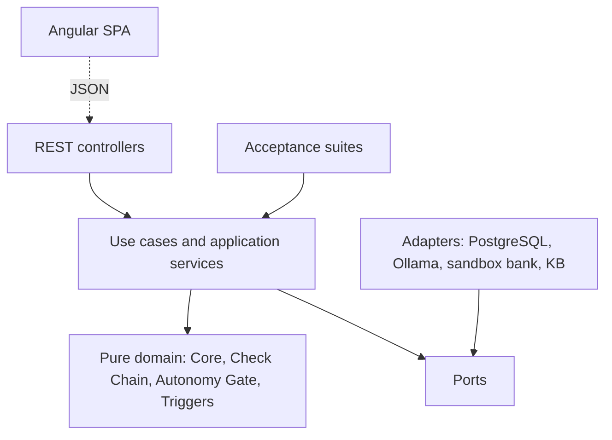
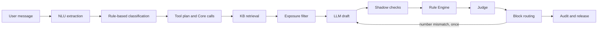
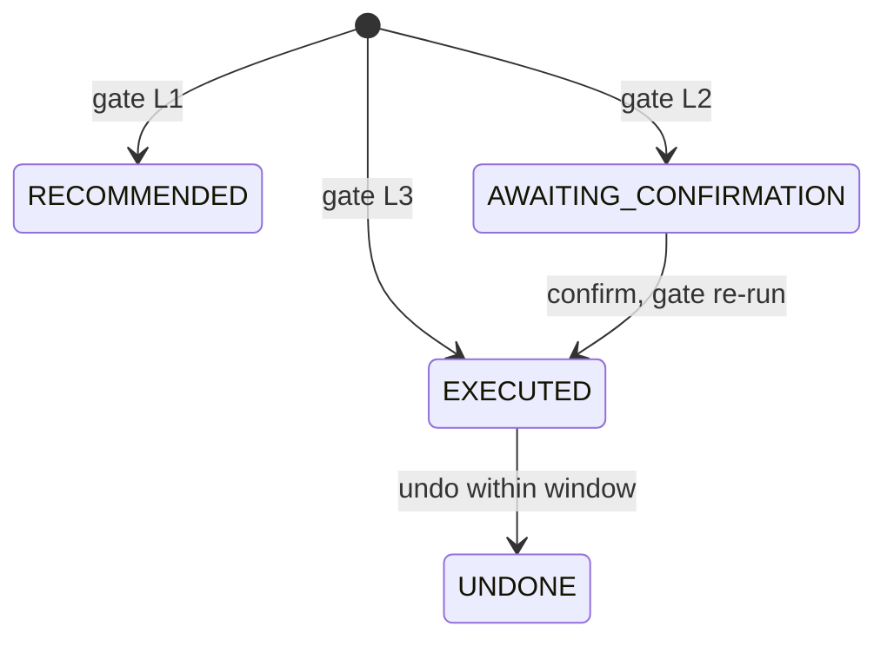

# Architecture of the Artifact

This chapter describes the architecture of the final application that serves as the Design Science Research (DSR) artifact. It answers two questions:

- Which structural decisions make the design principles of the thesis hold by construction rather than by convention? These principles are the Deterministic Core, the Autonomy Gate, the block-only Judge and data minimisation.
- How does the architecture make it possible to verify that each requirement is met?

Requirement identifiers (FR-n, SM-n) and the numbered Open Questions refer to the product requirements document. Architecture decisions (AD-n) refer to the architecture spine, which is the binding reference for implementation.

The experiments E1–E4 are a separate instrument. They run as standalone scripts in Google Colab and determine the design *parameters*: model, role prompt, compliance layers and data exposure. Their results enter the application only as versioned configuration (Section 8). This chapter covers the application itself.

## 1. Design Goals

The architecture serves the research questions, not production banking. Four goals follow from the requirements.

1. **Auditability by construction.** Every number, every product category and every approval must come from deterministic code that can be inspected and replayed. The language model must not be able to bypass this, even when it misbehaves.
2. **Enforceable autonomy.** Whether the agent may act on its own is decided by a deterministic function over explicit criteria and user-granted Mandates, never by the model.
3. **Verifiability.** Every requirement must be checkable against evidence the system produces itself, by automated acceptance tests and by inspecting audit records.
4. **Simplicity.** The author is a single researcher with limited time. The architecture therefore prefers a small number of proven technologies.

## 2. Architectural Style

The application is a **modular monolith** built with Spring Boot. It has a **hexagonal domain core** and an Angular single-page frontend.

The backend is divided into application modules: advisory chat, Deterministic Core, profile, monitoring, actions, escalation, audit, knowledge, sandbox bank, personas, language-model access and research tooling. Spring Modulith verifies their boundaries and dependency directions in a test (AD-12).

Inside each module, a *pure domain layer* holds the deterministic logic:

- the Core functions;
- the Check Chain;
- the Autonomy Gate;
- Trigger detection;
- response classification;
- the data-exposure filter.

This layer is plain Java. It performs no input or output, holds no state, uses no framework types and never calls a language model. It receives every input as an argument, including the simulated date, random seeds, Rule Parameter values and gate thresholds. Everything that touches the outside world is an adapter behind a port (AD-1): the database, the language model runtime, the sandbox bank and the web interface.

The style was chosen because it turns the central claim of the thesis into a structural property. The domain cannot depend on a model client, so no number or approval can originate from the model. An architecture test enforces this boundary.

Two alternatives were rejected:

- A microservice decomposition would add operational overhead without any research benefit.
- An agent framework in which the model calls tools itself contradicts FR-44 and would give the model control over which computations run.

## 3. The Advisory Turn as a Fixed Pipeline

Each chat message passes through a fixed sequence of stages, owned by a single orchestrator (AD-3). The order is fixed in code, and model output cannot change it.

**Understanding the request.** A dedicated language-model role (NLU) extracts intent, topic, scope signals, simulation parameters and any profile facts stated in the message. It returns structured JSON. Deterministic rules then derive the Expected Behavior class from the extracted intent, the product scope and the completeness of the customer profile (AD-4). Profile facts stated in a message apply to that turn only. A rule table per recommendation topic decides whether they suffice for a category recommendation, and missing facts are disclosed as limitations (AD-23).

**Computing.** The orchestrator, not the model, chooses which whitelisted Core functions to run, based on the class and the parameters. When parameters come from natural language, the user first sees and confirms them (AD-24). Every Core function returns a result that carries its inputs, its assumptions, the Rule Parameter versions it used and a list of *sourced numbers*.

Each sourced number has a deterministic *figure key*. The key is a hash of the persona, the function, its inputs, the simulated date and the configuration fingerprint. The same figure therefore has the same identity in the chat, the Financial Overview, a Notification and the "Why?" view. This lets the interface highlight a figure in the panel when the chat refers to it (AD-2, FR-8).

**Phrasing.** The phrasing model receives only a prompt payload that the exposure filter builds for the configured Data Exposure Level (raw, pseudonymised, aggregated or none). This also applies to the chat history. User input and retrieved passages are placed in delimited data slots. The model output is treated as text only: nothing parses it into a tool call, an Action or a profile change (AD-5). This is the architectural basis for the prompt-injection defence (FR-45).

**Checking and releasing.** A draft passes a closed list of deterministic checks:

- scope;
- profile completeness;
- suitability;
- cost transparency;
- no product naming;
- no guarantees or market timing;
- conflicts of interest;
- the IDD needs check;
- documentation;
- the Number Check;
- source validity.

Only the Rule Engine can approve a draft. The optional LLM Judge can return only *block* or *escalate*. One routing function maps block reasons to the response outcome (AD-6).

The Number Check compares every number in the draft with the sourced numbers of the turn. A mismatch triggers exactly one regeneration. If the regenerated draft also fails, the turn is escalated to a human advisor.

A response is released only together with its Audit Record, in one database transaction, and is never streamed token by token. Unchecked text therefore cannot reach the user (AD-7). Only dedicated use-case classes open transactions, and module services refuse to run outside one, so this guarantee is enforced at runtime (AD-21).

## 4. Compliance Layers as Configuration

The compliance stack is not a set of separate code paths:

- **A** is the compliance prompt.
- **B** is the enforcing Rule Engine.
- **C** is the block-only Judge.

The stack is one configuration value, interpreted by a single lookup table (AD-3).

| Stage | A | A+B | A+B+C |
|---|---|---|---|
| Classification | given as instruction | given | given |
| Core tool results | given | given | given |
| Shadow checks on first draft | computed | computed | computed |
| Rule Engine | shadow | enforcing | enforcing |
| Block routing | off | on | on |
| Judge | off | off | on |

The checks always run in *shadow mode* on the model's first draft. Every Audit Record therefore shows both what the model drafted and what the guardrails made of it. This makes the contribution of the enforcing layers visible in the evidence of each single response.

## 5. Autonomy: Mandates and the Autonomy Gate

Autonomous action follows the principle of *mandate, not discretion*. Only the monitoring loop proposes Actions. Chat never proposes them, and model output can never trigger one.

Every proposed Action enters one service. This service builds the gate context from a snapshot of the persona's accounts and from measures defined once in the Core:

- Data Confidence;
- liquid assets;
- the emergency-fund floor after the Action;
- the status of the Suitability Profile;
- the Mandate in force.

It then calls the Autonomy Gate. The gate is a pure function. It returns the maximum permitted level (L0–L3) together with the criteria that capped it (AD-10). The thresholds are stored in a configuration file, and a fingerprint of that file is recorded with every decision. Calibrating the thresholds (Open Question 2) therefore changes data, not code. L3 is possible only for an allowlist of three reversible Action types.

**Confirm, Undo and Revoke:**

- Confirming re-evaluates the same Action rather than creating a new one.
- Undo is a compensating Action within the reversibility window and is recorded as its own audited event.
- Revoking a Mandate takes effect immediately, because Mandate validity is re-checked at every execution.

Actions pass the same Check Chain as chat responses, and each one writes an Audit Record.

Monitoring runs over **simulated time**. Each persona has a stored simulated date, and no domain logic reads the real clock (AD-8). A monitoring run is idempotent and keyed per Trigger, so scenarios can be re-run and produce identical results (AD-16). No detector reads market prices, which makes the exclusion of market timing a structural property rather than a policy.

## 6. Knowledge and Rules with Validity

Hard rules, such as subsidy amounts, allowances and deadlines, are versioned Rule Parameter files with validity windows. Explanatory sources are Markdown documents with source, version and validity metadata, embedded into a vector index in PostgreSQL. Both are append-only, and both are identified by content-hash snapshots (AD-9).

- **Invalid rules.** A computation that needs a rule that is not valid at the simulated date is refused and escalated (FR-22).
- **Missing sources.** A general question with no valid source receives a transparent "no valid source" answer instead of model knowledge (FR-13).

This separation implements the principle that *the Knowledge Base explains and the Deterministic Core computes*.

## 7. Evidence and Requirement Verification

Every response, Notification and Action writes an append-only Audit Record. The database rejects updates, deletions and truncation. The application connects with a role that may only insert and read (AD-13).

A record holds:

- the classification and the response outcome;
- every check result, shadow and enforcing;
- the Judge verdict and the gate decision;
- the figure keys of all evidence used;
- model identifiers and digests and prompt hashes;
- the configuration fingerprint;
- the first draft and the released text.

The thesis evaluates the artifact by verifying that its requirements are met. These are the compliance requirements and the requirements set in the DSR relevance and rigor cycles. A user acceptance test with criteria complements this verification.

The architecture supports the verification in two ways:

- **Automated acceptance suites** (AD-15) run the Q&A test set and the Scenario Test Set against the real application services, with a real database and model runtime. They are not wrapped in test transactions, so they exercise the same code path and the same transaction boundaries as a user. Items that depend on persona data run as their backing persona (FR-51). Scenarios reset a persona, set its simulated date, run monitoring and assert the expected Trigger, Action and Autonomy Level.
- **Audit export.** The audit records of each suite run, and of user-acceptance sessions, can be exported. Each requirement can then be traced to concrete evidence. For example, the evidence can show that every released recommendation passed a complete Check Chain (SM-2), or that no Action ran above its permitted level (SM-5).

## 8. From Experiments to Configuration

The experiments determine design parameters. The application must therefore take over their results without unrecorded code changes. Experiment results enter only through a fixed set of versioned files (AD-25):

- the agent configuration (model per role, retrieval, role prompt, compliance level, data exposure level, decoding);
- the prompt templates;
- the autonomy thresholds;
- the profile minimum-field table;
- the model lock file.

Each file names the experiment and the result it was derived from.

At startup the application computes a fingerprint over these files and the Rule Parameters. It records this fingerprint in every Audit Record (AD-14). Any response can therefore be traced back to the experiment that justified its configuration. If a finding requires a structural change, the architecture is updated, not patched in code.

## 9. Models, Technology and Environments

**Models.** Language models are served by Ollama in 4-bit quantisation. They are pinned by digest in a lock file, and the application refuses to start on a mismatch (AD-18). The backend calls Ollama's native API through a thin client of its own. This gives full control over seeds, context length and structured output. The candidate models are Llama 3.1 8B, Llama 2 7B and the Llama-2-based finance-chat model, and the E1 result selects among them.

**Technology:**

- Backend: Java 25 and Spring Boot 4.1 with Spring Modulith.
- Persistence: PostgreSQL 17 with pgvector, for application state, audit and retrieval.
- Frontend: Angular 22, with an API client generated from the backend's OpenAPI description.

The frontend never computes financial values. It displays figures from the backend and asks the backend to recompute (AD-19).

**Environments.** The application runs in two environments from one container image and one Docker Compose definition (AD-17):

| Environment | Purpose | Composition |
|---|---|---|
| Local PC | Development and testing | Application, PostgreSQL 17 with pgvector, Ollama |
| Azure GPU VM (EU) | Demo and user acceptance test | The same composition plus a TLS proxy |

## 10. Key Design Decisions and Alternatives

| Decision | Chosen | Alternatives considered | Reason |
|---|---|---|---|
| Who invokes tools | Orchestrator, from deterministic classification | Native LLM function calling | No model influence on computations; models without function calling work equally |
| Classification | Dedicated NLU role plus deterministic rules | Phrasing model classifies; pure keyword rules | Classification stays stable when the phrasing model changes; more robust than keywords alone |
| Approval | Rule Engine only; Judge may block or escalate | LLM-as-judge with approval power | Preserves deterministic enforcement; rejected during concept development |
| Release | Atomic with Audit Record, no streaming | Token streaming | Unchecked text could otherwise reach the user |
| Module structure | Modular monolith with verified module boundaries | Microservices; unstructured monolith | Clear ownership of data at low operational cost |
| Datastore | PostgreSQL with pgvector for state, audit and retrieval | Separate vector store | One store, transactional audit, identical in all environments |
| Model access | Own thin Ollama client | Spring AI | Full control over seed, context length and structured output |
| Experiment results | Versioned configuration with fingerprint | Code changes | Traceability from experiment to deployed behaviour |

## 11. Limitations

- **Quantisation.** The models run in 4-bit quantisation with a limited context window. Absolute answer quality may therefore be lower than with full-precision weights.
- **Rule-based classification.** The architecture guarantees auditability, not correctness. A wrong deterministic rule produces a wrong answer reproducibly. This is consistent with the core claim of the thesis that the hybrid guarantees auditability, not truth.
- **Single-instance deployment.** One virtual machine hosts the application. This is sufficient for synthetic personas and a small user acceptance test, but it says nothing about production scalability.
